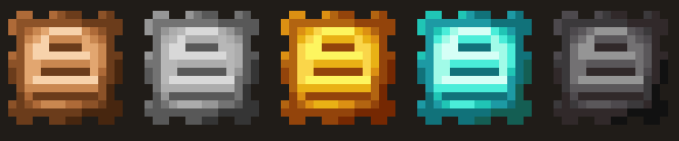

[](https://github.com/Huziyang520/TravelersBackpack-StackUpgrades)
[](https://github.com/Huziyang520/TravelersBackpack-StackUpgrades/issues)
[](https://github.com/Huziyang520/TravelersBackpack-StackUpgrades)

---

# 🎒 Traveler's Backpack: Stack Upgrades

*Authors*: Poluo_0, Huziyang520

An addon mod for **[Traveler's Backpack](https://www.curseforge.com/minecraft/mc-mods/travelers-backpack)** (Fabric and NeoForge). This mod introduces **5 stack upgrade plugins** to the backpack's side panel, allowing you to multiply and boost item stack limits for individual slots inside the backpack.

---

## 📦 Upgrade Tiers & Capacity

Slot capacity formula: `floor(item's base max stack size × total multiplier)`, with a default hard cap of `1,073,741,824`.

| Upgrade Tier | Stack Multiplier | 64 items/stack | 16 items/stack | Non-stackable items (Tools/Armor) |
| --- | --- | --- | --- | --- |
| **Starter** | ×1.5 | 96 | 24 | 1 (rounded down) |
| **Tier 1** | ×2 | 128 | 32 | 2 |
| **Tier 2** | ×4 | 256 | 64 | 4 |
| **Tier 3** | ×8 | 512 | 128 | 8 |
| **Tier 4** | ×16 | 1024 | 256 | 16 |

---

## ⚡ Multiplier Stacking Rules

- **Multiplicative Stacking**: Each additional stack upgrade of the same or different tiers multiplies the total factor further (**multiplicative rather than additive**).

---

## 🛠️ Crafting Recipes

Recipes utilize vanilla materials and **[Traveler's Backpack](https://www.curseforge.com/minecraft/mc-mods/travelers-backpack)** blank upgrades.

- **`X`** represents the corresponding metal block of that tier.
- **`S`** represents the previous tier upgrade (a blank upgrade can also be used for Tier 1).

```text
Starter             Tier 1              Tier 1 (Alternative)
  C C C                 I                 X X X
  C B C               I S I               X S X
  C C C                 I                 X X X

```

| Output | Crafting Recipe |
| --- | --- |
| **Starter** | 8 Copper Blocks surrounding 1 Blank Upgrade |
| **Tier 1** | 1 Starter + 4 Iron Ingots, or 8 Iron Blocks surrounding 1 Blank Upgrade |
| **Tier 2** | 8 Gold Blocks surrounding 1 Tier 1 Upgrade |
| **Tier 3** | 8 Diamond Blocks surrounding 1 Tier 2 Upgrade |
| **Tier 4** | 8 Netherite Blocks surrounding 1 Tier 3 Upgrade |

---

## ⚙️ Configuration

The configuration screen can be opened via the "Config" button of the mod list. On Fabric it needs Mod Menu and Forge Config API Port installed; without them the defaults are used.

### Configuration File `config/tbstackupgrades-common.toml`:

* `allowNonStackableItems = true` — Whether items with a maximum stack size of 1 (tools, armor) also benefit from the multiplier.
* `allowDuplicateStackUpgrades = true` — Whether duplicate stack upgrades of the same tier are allowed to be installed simultaneously.
* `maxSlotLimit = 1073741824` — Single slot limit hard cap (range 64–1073741824).
* `lootEnabled = true` — Whether upgrades can be generated in structure loot tables.
* `lootChanceMultiplier = 1.0` — Multiplier for all loot generation chances (range 0–5).
* `lootTier4Chance = 0.01` — Chance of finding Tier 4 upgrades in Bastion Remnants.

> **Loot Generation**: Loot progresses with game progression. Early structures drop Starter and Tier 1, mid-game structures add Tier 2, Tier 3 is restricted to late-game structures, and Tier 4 is exclusively found in Bastion Remnant chests.

### Client Configuration `config/tbstackupgrades-client.toml`:

* `quickTransferStacking = true` — When Shift-clicking, items with non-64 stack sizes will also merge into the backpack.
* `sorterStacking = true` — The sorting button merges stacks based on upgraded single-slot capacities.

---

## 📌 Behavior Notes

* **Extraction Limit**: When extracting from the backpack, a maximum of one vanilla stack (64 items) can be taken out per click; the remainder stays inside the slot. Players will not receive oversized stacks into their personal inventory. Insertion is not restricted.
* **One-Click Sorting**: The sort button does not split or combine oversized stacks; they remain intact within their original slots.
* **Removal Protection**: If the backpack contains stacks exceeding the capacity limit after removing an upgrade, clicking the side panel icon to remove the plugin will be blocked, and a red error prompt will appear at the top (or bottom if space is limited) of the backpack interface.
* **Digital Display**: When hovering over items in the backpack, tooltips display a cyan `Count / Limit`, visible only when upgrades are installed and the limit exceeds 64. Slot counts exceeding 3 digits scale down proportionally to avoid overlapping adjacent slots.
* **Placement Behavior**: When the backpack is placed on the ground and opened, it shares the exact same storage data and consistent behavior.
* **Cross-Mod Compatibility**: Stackable items from other mods calculate limits based on their own max stack sizes and receive proportional enhancements.

---

## 📜 License

This mod is dual-licensed under **LGPL-3.0-or-later OR MIT**:

* Mixin Injection Layer: `LGPL-3.0-or-later OR MIT`
* Remaining Code: `MIT`
* Textures: `LGPL-3.0` (The plate outline textures are derived from the built-in upgrade icons of Traveler's Backpack; stack symbols and mod icons are custom-drawn for this mod).
* **[Traveler's Backpack](https://www.curseforge.com/minecraft/mc-mods/travelers-backpack)** is licensed under [LGPL-3.0](https://www.gnu.org/licenses/lgpl-3.0.html) and serves as a required prerequisite. This mod does not copy or bundle any of its code, textures, models, or language files. It is installed separately by players at runtime and communicates purely through its public API and Mixin injection points.

---

## 🐛 Issue Tracker

[https://github.com/Huziyang520/TravelersBackpack-StackUpgrades/issues](https://github.com/Huziyang520/TravelersBackpack-StackUpgrades/issues)

---

# 🎒 旅行者背包：堆叠升级

*作者*：Poluo_0、Huziyang520

为 **[旅行者背包 (Traveler's Backpack)](https://www.curseforge.com/minecraft/mc-mods/travelers-backpack)**（Fabric 与 NeoForge）打造的附属模组。本模组在背包侧栏新增了 **5 种堆叠升级插件**，放入后即可按倍率提升背包内单个格子的物品堆叠上限。

---

## 📦 升级等级与容量

单格容量计算公式：`floor(物品自身最大堆叠数 × 总倍率)`，默认硬顶为 `1,073,741,824`。

| 升级类型 | 堆叠倍率 | 64 个/组物品 | 16 个/组物品 | 不可堆叠物品（工具/装备） |
| --- | --- | --- | --- | --- |
| **入门 (Starter)** | ×1.5 | 96 | 24 | 1（向下取整） |
| **一级 (Tier 1)** | ×2 | 128 | 32 | 2 |
| **二级 (Tier 2)** | ×4 | 256 | 64 | 4 |
| **三级 (Tier 3)** | ×8 | 512 | 128 | 8 |
| **四级 (Tier 4)** | ×16 | 1024 | 256 | 16 |

---

## ⚡ 倍率叠加规则

* **乘算叠加**：每多装一个堆叠升级就会再乘一次倍率（**乘算而非加算**）。

---

## 🛠️ 合成配方

配方均使用原版材料与 **[旅行者背包](https://www.curseforge.com/minecraft/mc-mods/travelers-backpack)** 的空白升级。

* **`X`** 代表对应等级的金属块
* **`S`** 代表上一级升级（一级也可用空白升级）

```text
入门                 一级                   一级（备用）
  C C C                 I                 X X X
  C B C               I S I               X S X
  C C C                 I                 X X X

```

| 产物 | 合成配方 |
| --- | --- |
| **入门** | 8 个铜块围 1 个空白升级 |
| **一级** | 1 个入门 + 4 个铁锭，或 8 个铁块围 1 个空白升级 |
| **二级** | 8 个金块围 1 个一级 |
| **三级** | 8 个钻石块围 1 个二级 |
| **四级** | 8 个下界合金块围 1 个三级 |

---

## ⚙️ 配置

模组列表里的“配置”按钮可打开配置界面；Fabric 下需要安装 Mod Menu 与 Forge Config API Port，未安装时按默认值运行。

### 配置文件 `config/tbstackupgrades-common.toml`：

* `allowNonStackableItems = true` —— 最大堆叠数为 1 的物品（工具、护甲）是否也吃倍率。
* `allowDuplicateStackUpgrades = true` —— 同等级的堆叠升级是否允许重复安装。
* `maxSlotLimit = 1073741824` —— 单格上限硬顶（范围 64–1073741824）。
* `lootEnabled = true` —— 是否把升级放进结构战利品。
* `lootChanceMultiplier = 1.0` —— 所有战利品概率的倍率（范围 0–5）。
* `lootTier4Chance = 0.01` —— 堡垒遗迹出四级升级的概率。

> **战利品生成**：战利品按游戏进程推进。早期结构出入门与一级，中期结构加入二级，三级只在末期结构，四级仅限堡垒遗迹宝箱。

### 客户端配置 `config/tbstackupgrades-client.toml`：

* `quickTransferStacking = true` —— Shift 快速转移时，最大堆叠数不是 64 的物品也会合并进背包。
* `sorterStacking = true` —— 整理按钮按升级后的单格容量合并堆叠。

---

## 📌 行为说明

* **取出限制**：从背包取出时每次最多取一个原版堆叠（64 个），剩余留在格子里，玩家背包里不会出现超量堆叠；放入不受此限制。
* **一键整理**：排序按钮不会拆分或合并超大堆叠，会保持整组待在原格子里。
* **拆卸保护**：背包内若还有超过“拆下后上限”的堆叠，点击侧栏图标拆下插件会被拒绝，并在背包界面上方（空间不足时下方）显示红字提示。
* **数字显示**：悬停背包内物品时，提示里多出青色的 `数量 / 上限`，仅在装了升级且上限高于 64 时显示。单格数量超过 3 位时数字会等比缩小，不会盖住相邻格子。
* **放置行为**：背包放地上打开时共用同一套存储，行为一致。
* **跨模组兼容**：其它 MOD 的可堆叠物品按自身最大堆叠数计算，同样获得提升。

---

## 📜 许可证

本模组采用 **LGPL-3.0-or-later OR MIT** 双许可：

* Mixin 注入层：`LGPL-3.0-or-later OR MIT`
* 其余代码：`MIT`
* 贴图：`LGPL-3.0`（贴图的板身轮廓取自旅行者背包自带的升级图标，堆叠符号与模组图标为本 MOD 自绘）
* **[旅行者背包 (Traveler's Backpack)](https://www.curseforge.com/minecraft/mc-mods/travelers-backpack)** 采用 [LGPL-3.0](https://www.gnu.org/licenses/lgpl-3.0.html)，是必需前置。本模组不复制、不打包其任何代码、贴图、模型或语言文件，运行时由玩家自行安装，只通过其公开 API 与 Mixin 注入点协作。

---

## 🐛 问题反馈

[https://github.com/Huziyang520/TravelersBackpack-StackUpgrades/issues](https://github.com/Huziyang520/TravelersBackpack-StackUpgrades/issues)